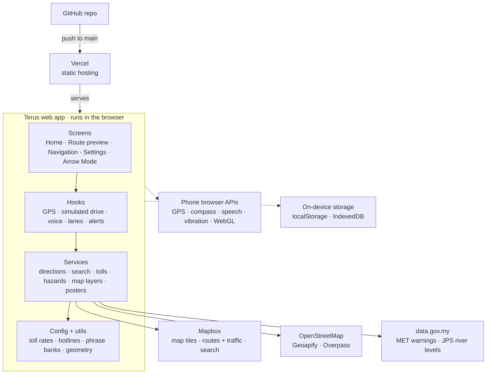

# Terus

**Malaysia-first, minimalist 3D navigation in the browser.**
Drive, walk or cycle with lane-level guidance, real toll estimates, official flood and weather alerts, and a few fun extras, all from a phone browser with no app install and no backend.

**Live demo:** https://terus-navigation.vercel.app
**Try it fast:** open the live site and tap **Lanes & tolls demo** for a simulated drive (no GPS needed).

---

## Features

| | |
|---|---|
| 🗺️ **3D map** | Mapbox Standard 3D map, day / night / auto, 2D option. Buildings in front of the car are cut away so they never hide it. |
| 🔎 **Search** | Mapbox + OpenStreetMap (Geoapify) for Malaysian streets and *taman*, 15 quick buttons (petrol, hospital, surau, toilet…), long-press to drop a pin. |
| 🚗🚶🚲 **Car / walk / cycle** | Up to 4 route choices. Walking and cycling can prefer **shade** (sun position + building heights) or **shelter** (covered walkways). |
| 🛣️ **Lane guidance** | Lane arrows, junction view, a lane voice cue, and a lane-level road drawn on the map with a green guide path. |
| 💰 **Tolls** | Class 1 toll estimates from checked published rates, a "next toll" card, and a reminder 1 km before each plaza. |
| 🌊 **Flood & weather alerts** | Official MET Malaysia warnings and JPS river levels (data.gov.my) matched to your route, with a banner, map colouring, voice alerts and "Avoid flood areas". Terus never makes its own predictions. |
| ➡️ **Arrow Mode** | One big compass arrow instead of a map, with voice in English, Malay and Chinese. |
| 🆘 **SOS** | Malaysian highway, LLM, insurance and emergency hotlines, plus copy / share your location. |
| 🦸 **Fun extras** | Avatars (durian, kucing, tapir, teh tarik…) or upload your own `.glb`. Voice personalities (Mak Cik, Abang Grab, Ah Beng, Cikgu Garang) that only joke *after* the real instruction. "DICARI / WANTED" posters for potholes, with "Send to MyJalan". |

Detailed notes, data sources and limits for each feature: **[docs/features.md](docs/features.md)**.

---

## Technical architecture

Terus is a **static single-page app**. Vercel only serves the built files; everything runs in the phone's browser and talks directly to official or open data services. Every push to `main` on GitHub redeploys the site.



### Layers

| Layer | Folder | What it does |
|---|---|---|
| Screens | `src/screens`, `src/components` | What you see and tap. No network calls. |
| Hooks | `src/hooks` | Live state: GPS position, the simulated car, when to speak, lane view, alert refreshes. |
| Services | `src/services` | The actual work: fetch and parse routes, estimate tolls, match warnings to the route, draw map layers, render posters, build 3D models. |
| Config & data | `src/config`, `src/config/data` | Checked data: toll rates, SOS hotlines, avatar presets, joke and poster phrase banks, district boundaries. |
| Utils / models / i18n | `src/utils`, `src/models`, `src/i18n` | Geometry, formatting, shared types, English / Malay / Chinese text. |

### External services

| Service | Used for | Free tier / notes |
|---|---|---|
| **Mapbox** | 3D map, Directions (traffic, lanes, toll plazas, speed limits), Search Box, Geocoding, Vector Tiles | 50k map loads · 100k route requests / month |
| **Geoapify (OpenStreetMap)** | Malaysian street and *taman* search, reverse geocoding | 3k requests / day |
| **Overpass (OpenStreetMap)** | Covered walkways, lane counts (best effort) | Public servers, cached |
| **data.gov.my** | MET Malaysia warnings and forecast, JPS river levels | No key; cached 10 min – 3 h. The JPS feed has not updated since Feb 2024, so old readings are ignored. |
| **Browser APIs** | Geolocation, DeviceOrientation, Web Speech, Vibration, Wake Lock, WebGL | Built into the phone |

### Key design decisions

- **No backend.** Lower cost and nothing to maintain. Reports, avatars and settings stay on the device, behind a `ReportsRepository` interface so a server can be added later.
- **Safety first in the voice.** The real instruction is always spoken first; jokes are optional tags, never near a turn, never for flood or SOS alerts, at most one every 2 minutes.
- **Honest data.** Tolls use only checked rates ("Not priced" otherwise), and alerts always show their official source and time.
- **Light on mid-range phones.** The 3D preview (three.js) and the district boundaries only download when needed; avatars stay under 4,000 triangles.

### Stack

Vite · React 19 · TypeScript (strict) · mapbox-gl 3 · three.js (avatar preview only) · @mapbox/vector-tile + pbf · suncalc

---

## Run it locally

Requirements: Node.js 20+ and a free [Mapbox](https://account.mapbox.com) account.

```bash
npm install
cp .env.example .env.local     # then paste your keys (see below)
npm run dev                    # http://localhost:5173
```

| Variable | Required | What it is |
|---|---|---|
| `VITE_MAPBOX_TOKEN` | ✅ | Mapbox **public** token (`pk.…`). Never use a secret `sk.` token. |
| `VITE_GEOAPIFY_KEY` | optional | Free [Geoapify](https://myprojects.geoapify.com) key for street-name search. |

**On your phone (GPS needs https):** run `npm run dev:phone`, open the `https://192.168.x.x:5173` address it prints (same Wi-Fi), accept the test-certificate warning, and add that address to your Mapbox token's URL restrictions.

### Demo modes

| URL | What it does |
|---|---|
| `/?demo=1` | Arrow Mode walks the route by itself (for indoor presenting) |
| `/?demo=flood` | Adds a fake flood and thunderstorm alert (labelled DEMO) to every route |
| `/?demo=fun` | Mak Cik voice, durian avatar and a sample pothole poster |
| `/?navcheck=1` | Dev check page (105 checks: lanes, tolls, alerts, avatars, voices, posters) |

The same checks run in a terminal: `npx tsx src/dev/runNavChecks.ts`.

## Deploy (Vercel)

1. Import the GitHub repo at [vercel.com/new](https://vercel.com/new); the Vite preset is detected automatically (`npm run build` → `dist`).
2. Add `VITE_MAPBOX_TOKEN` and `VITE_GEOAPIFY_KEY` under **Environment Variables**.
3. Deploy. Later pushes to `main` redeploy automatically. After changing a variable, use **Redeploy**.

## Security

- `.env.local` is git-ignored; keys live only there and in Vercel's settings.
- The Mapbox public token is visible in the published site, so restrict it to your URLs (Mapbox → Tokens → URL restrictions) and set a billing alert.
- Never handle the phone while driving: report and detail actions only work when stopped (or as a passenger).

## Credits & data licences

Maps, routes and traffic © Mapbox · © OpenStreetMap contributors · Street search by Geoapify · Weather warnings and forecast: MET Malaysia · River levels: JPS · District boundaries: DOSM – all via data.gov.my, subject to the Malaysian Government Open Data Terms of Use 1.0. Toll rates checked against official sources (Nov 2026). Avatars, voice lines and poster art are original.
